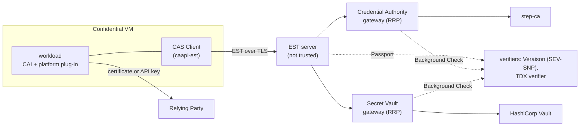

# attestation-bench

A reproducible test bench for **TACRA**, Trustworthy Acquisition of Credentials using Remote Attestation. In TACRA, a
workload in a confidential VM gets a credential (an X.509 certificate or an API key) only after its hardware has proven
what it runs, and the request travels through intermediaries it does not trust.

With this repository you can:

- **run TACRA end to end on real hardware**, AMD SEV-SNP and Intel TDX, in your own Google Cloud or AWS account:
  nothing stands in for the hardware;
- **attack it**: change one input at a time and see each refused for its own reason;
- **replay the redirection experiment** ([TACRA issue #20](https://github.com/TheBankster/rats-tacra/issues/20)): one
  Evidence offered to two Credential Authorities, also with the second keeping an epoch of its own or the intermediary
  starting there, and to two Secret Vaults, and what the intermediary relays rewritten
  ([#19](https://github.com/TheBankster/rats-tacra/issues/19)), in Background Check and in Passport;
- **bring up a fictional bank** in the cloud, whose payment service gets its database certificate and partner API key
  only by attestation, and **make banks of your own** from it (`make bank-new`);
- **keep every run as evidence**: each run writes a directory with what it did, its results, its verdict (`PASS` or
  `FAIL`) and the SHA-256 of every file; `make report` lists them all.

> **Private.** Built for the TWI SIG's TACRA work: the architecture draft
> [draft-novak-rats-tacra](https://datatracker.ietf.org/doc/draft-novak-rats-tacra/) and its EST profile,
> [draft-novak-lamps-tacra-est](https://github.com/TheBankster/lamps-tacra-est), whose reference implementation is
> [tacra-est](https://github.com/nikolaichuk7/tacra-est). The TACRA proof of concept this bench builds on is the
> SIG's; the bench keeps the parts of it that it runs ([CONTRIBUTING.md](CONTRIBUTING.md)). How this release was
> checked: [docs/verification.md](docs/verification.md).

## Quick start

You need macOS or Linux, Go 1.26.5 or later, Python 3.10 or later, and a Google Cloud project or an AWS account that
can create confidential VMs, with its CLI signed in ([docs/hardware/](docs/hardware/README.md)). `make doctor` checks
the rest and says how to install what is missing.

```bash
make doctor                     # checks this machine; ends with "Ready for make setup."
make setup                      # builds and starts the trust zone in ~/.attestation-bench
make check-mtls                 # VERDICT PASS: 40 of 40 checks as expected: only the allowed components, over TLS 1.3
make test-live                  # the EST wire format, and the committed runs appraised again by the live verifiers
make demo     PLATFORM=gcp-snp  # VERDICT PASS: all 10 Targets: …; admitted under the bench's waiver: Milan bit 4: …
make attacks  PLATFORM=gcp-snp  # VERDICT PASS: 262 checks: …; … the bench's waiver …; exposure, the guest's clock: …
make redirect PLATFORM=gcp-snp  # the #20 table, then the conduit's #19 rewrites (PASSPORT=1: in Passport)
```

On SEV-SNP every verdict names the bench's waiver: the platform rule requires the mitigation bit AMD-SB-3034
names for Milan, no Google Cloud or AWS host sets it, and a bank's rule refuses those hosts
([docs/limits.md](docs/limits.md)).

The trust zone (the EST server, the RRP gateways, the verifiers, step-ca, Vault) runs on your machine. There is no
run without the cloud: nothing stands in for the hardware. Each run of the protocol creates one small confidential VM
in the project or account your `gcloud` or `aws` CLI is signed in to, runs the workload in it, copies the results
back, deletes the VM and checks that it is gone. Every run judges itself against what its experiment expects and ends
with `VERDICT PASS` or `VERDICT FAIL`; on FAIL, `make` fails. Step by step, with what each step prints:
[docs/getting-started.md](docs/getting-started.md).

| `PLATFORM` | Hardware | Machine | Report signed by |
|---|---|---|---|
| `gcp-snp` | AMD SEV-SNP, Google Cloud | `n2d-standard-2`, AMD Milan | the chip's VCEK |
| `gcp-tdx` | Intel TDX, Google Cloud | `c3-standard-4` | the TD's Quoting Enclave, certified by Intel (PCK) |
| `aws-snp` | AMD SEV-SNP, AWS EC2 | `c6a.large` | a VLEK: AMD's key for the cloud provider |

Setup, quotas, cost and cleanup per platform: [docs/hardware/](docs/hardware/README.md). The cloud Demo Bank:
[docs/demo-bank.md](docs/demo-bank.md).

## How it fits together



The workload asks for a credential for a **Target**. Its platform plug-in binds the request (the freshness element, the
Target, the RRP's identifier, and the CSR or the key that will receive the secret) into the hardware report. The
**RRP**, the party that issues or releases the credential, recomputes that binding itself and checks the verifier's
signed result (an EAR) before it acts. Everything between the workload and the RRP may be hostile: the EST server, the
network, the cloud. The ideas in plain words: [docs/concepts.md](docs/concepts.md); the components and ports:
[docs/architecture.md](docs/architecture.md).

## Status (7 October 2026)

| What | Result | Evidence |
|---|---|---|
| The trust zone, `make check-mtls`: mutual TLS between all components | 40 of 40, in Passport and in Background Check | [Passport](e2e/evidence/20261007T172815Z-bench-mtls-passport), [Background Check](e2e/evidence/20261007T172900Z-bench-mtls-background-check) |
| Hardware, `make demo`, three platforms × two RATS models | 10 of 10 Targets in each of the six runs. On TDX under the platform rule; on SEV-SNP only under the bench's named waiver `admitted without bit 4, AMD-SB-3034`, which each verdict names: no Google Cloud or AWS host attests that fix ([docs/limits.md](docs/limits.md)) | e.g. [GCP SEV-SNP, Passport](e2e/evidence/20261007T174229Z-gcp-sev-snp-e2e-passport), [AWS SEV-SNP, Background Check](e2e/evidence/20261007T173657Z-aws-sev-snp-e2e-background-check), [GCP TDX, Passport](e2e/evidence/20261007T174534Z-gcp-tdx-e2e-passport) |
| Hardware, `OTHER_PLATFORM=1 make demo` (tacra-est N24) | each platform's genuine Evidence refused at the Target of the other platform's verifier: in Passport after appraisal, in Background Check before it | [GCP SEV-SNP](e2e/evidence/20261007T175538Z-gcp-sev-snp-e2e-passport-other-platform), [AWS SEV-SNP](e2e/evidence/20261007T175845Z-aws-sev-snp-e2e-passport-other-platform), [GCP TDX](e2e/evidence/20261007T180040Z-gcp-tdx-e2e-passport-other-platform), [GCP TDX, Background Check](e2e/evidence/20261007T173902Z-gcp-tdx-e2e-background-check-other-platform) |
| Hardware, `UNAPPROVED=1 make demo`: an SEV-SNP launch the bench does not approve (four vCPUs) | 10 of 10 Targets refused, Veraison `contraindicated` | [GCP SEV-SNP](e2e/evidence/20261007T175016Z-gcp-sev-snp-e2e-passport-unapproved), [AWS SEV-SNP](e2e/evidence/20261007T175320Z-aws-sev-snp-e2e-passport-unapproved) |
| Hardware, `make attacks` | every attack refused for its own reason: 262 checks on each SEV-SNP platform and 162 on TDX, the platform rule's among them (the bench's admits the honest results, on SEV-SNP under its waiver; a bank's refuses SEV-SNP for bit 4; a rule one step stricter refuses them all). And an exposure, reported as one: Evidence made with the guest's clock 300 s ahead, absent-timestamp, was taken from 295 s to 420 s after it was made (`max_age` 120 s), the same Evidence each time; the four other Freshness Kinds were taken at once, not resting on the guest's clock; made with it behind, refused | [GCP SEV-SNP](hwcheck/evidence/20261007T212531Z-gcp-sev-snp), [GCP TDX](hwcheck/evidence/20261007T214424Z-gcp-tdx), [AWS SEV-SNP](hwcheck/evidence/20261007T213607Z-aws-sev-snp) |
| Hardware, `make redirect` | 20 of 20 cases on each platform: with the RRP identifier the second Credential Authority refused all five Freshness Kinds; without it, all but present-nonce (the two sharing one epoch marker, on Evidence made for the first) | [GCP SEV-SNP](hwcheck/evidence/20261007T182724Z-gcp-snp-redirect), [GCP TDX](hwcheck/evidence/20261007T183127Z-gcp-tdx-redirect), [AWS SEV-SNP](hwcheck/evidence/20261007T183448Z-aws-snp-redirect) |
| Hardware, `REDIRECT_VARIANT=own-epochs`, `start-ca2` and `vault`, `make redirect` | 20 of 20 cases in each of 18 runs, the three platforms in both RATS models: with an epoch marker of its own the second Credential Authority issued without the RRP identifier for absent-timestamp and absent-none alone; when the conduit started the exchange there, for every kind but absent-epoch, present-nonce included; on the Secret Vaults, the second released the key for every kind but present-nonce; with the identifier the second refused all five in each | [docs/attacks.md](docs/attacks.md), section 2 |
| Hardware, `REDIRECT_VARIANT=replay` and `replay-vault`, `make redirect` | 10 of 10 outcomes in each of 12 runs, the three platforms × the Credential Authority and the Secret Vault × both RATS models: the same request a second time is refused with present-nonce (the Handle serves once) and served again with the other four Freshness Kinds, so one Evidence yields two credentials, or two releases, unless the kind is present-nonce; both for the Attester's own key | [GCP SEV-SNP](hwcheck/evidence/20261008T184000Z-gcp-snp-redirect-replay), [GCP TDX](hwcheck/evidence/20261008T190244Z-gcp-tdx-redirect-replay), [AWS SEV-SNP](hwcheck/evidence/20261008T185320Z-aws-snp-redirect-replay); the other nine beside them |
| Hardware, the protocol without the RRP identifier, `OMIT_RRP_ID=1`: `make demo`, `make attacks`, the replay variants in both passes, `CONDUIT_ATTACK=…` | 33 runs, each as the run of its kind with the identifier: 10 of 10 Targets in each of 6 demos; every substitution refused in each of 3 attack runs (no identifier to substitute); 12 replay runs the same in both passes; 12 drills as before. What differs is the redirection alone ([docs/attacks.md](docs/attacks.md), section 8) | [GCP SEV-SNP](e2e/evidence/20261008T202206Z-gcp-sev-snp-e2e-passport-no-rrp-id), [GCP TDX](e2e/evidence/20261008T202708Z-gcp-tdx-e2e-passport-no-rrp-id), [AWS SEV-SNP](e2e/evidence/20261008T202505Z-aws-sev-snp-e2e-passport-no-rrp-id); the other thirty beside them |
| The conduit, `make redirect` (#19), `PASSPORT=1` | on Evidence made for the first Credential Authority, the conduit's 20 rewrites as [docs/attacks.md](docs/attacks.md), section 2, says: a made-up Handle, the Freshness Kind, a credential type not offered and another workload's Credential Hint refused; the other offered credential type issued for every kind but present-nonce, as nothing binds it. In Passport, with Attestation Results instead of Evidence, the same 40 outcomes, the redirection included | Background Check: [GCP SEV-SNP](hwcheck/evidence/20261007T204444Z-gcp-snp-redirect), [GCP TDX](hwcheck/evidence/20261007T204937Z-gcp-tdx-redirect), [AWS SEV-SNP](hwcheck/evidence/20261007T205428Z-aws-snp-redirect); Passport: [GCP SEV-SNP](hwcheck/evidence/20261007T205826Z-gcp-snp-redirect-passport), [GCP TDX](hwcheck/evidence/20261007T210314Z-gcp-tdx-redirect-passport), [AWS SEV-SNP](hwcheck/evidence/20261007T210728Z-aws-snp-redirect-passport) |
| What attest-initiate costs (#19), `make demo` | of 60 acquisitions on the three platforms in both models, the median Initiate took 259 ms from the guest, through the bench's SSH tunnel to the EST server, of a 564 ms acquisition; 1.35 ms of it in the EST server and the RRP. A CAS client that completed Initiate locally would save that round trip | e.g. [GCP SEV-SNP, Passport](e2e/evidence/20261007T215301Z-gcp-sev-snp-e2e-passport), [AWS SEV-SNP, Background Check](e2e/evidence/20261007T220649Z-aws-sev-snp-e2e-background-check) |
| The conduit and the Retrieval container, `CONDUIT_ATTACK=… make demo` | in each of 12 runs (4 container drills × 3 platforms) the 5 Enrollments admitted, and each Retrieval the conduit acted on refused: its own container (TACRA's option of the CAS Server encrypting to CEKpub) for its origin; the Vault's container of the Retrieval before for its associated data; a hint the Target serves no group to by the Vault; the hint of another group it serves to the same launches, whose secret the Vault released, by the CAI. In the `verifier` drill (3 runs, the EST server as the attacking conduit in Passport) each Enrollment's Attestation Results, signed again with the conduit's own key, were refused by the Credential Authority, none of the verifiers it takes having signed them; the 5 Retrievals admitted. Which check carries it: [docs/attacks.md](docs/attacks.md), section 6 | e.g. [GCP SEV-SNP, seal](e2e/evidence/20261008T003630Z-gcp-sev-snp-e2e-passport-conduit-seal), [AWS SEV-SNP, hint-group](e2e/evidence/20261008T010204Z-aws-sev-snp-e2e-passport-conduit-hint-group), [GCP TDX, swap](e2e/evidence/20261008T004908Z-gcp-tdx-e2e-passport-conduit-swap), [GCP SEV-SNP, verifier](e2e/evidence/20261008T234813Z-gcp-sev-snp-e2e-passport-conduit-verifier) |
| The Demo Bank in the cloud | its rule waives nothing: the payment from TDX went through; the payments from Google Cloud and AWS SEV-SNP were refused for bit 4; an ordinary VM and an unapproved launch got no credential; in Passport and in Background Check | [Passport](e2e/evidence/20261007T183914Z-demo-bank), [Background Check](e2e/evidence/20261007T193224Z-demo-bank) |
| A bank of your own, `make bank-new NAME=acme-bank` | its own Targets, RRP identifiers and names: the ledger admitted `payments.workload.acme-bank.example` from TDX; the payment from GCP SEV-SNP was refused for bit 4, as the Demo Bank's | [run](e2e/evidence/20261007T195519Z-acme-bank) |

The runs above are the release check of v0.1.0, made on 7 October 2026 from a fresh clone of the GitHub repository;
two runs made at v0.1.0 after it, the Demo Bank in Background Check and a bank of your own; and that evening the
attacks with the guest's clock moved both ways, the conduit and the timed demos (`0505d29`, `758b0ff`, `21f79e1`). The demos, attacks and
redirect runs were each compared check by check with the run of its kind before it: the same outcomes. The demos and
redirect runs before them were made before the platform rule required AMD's mitigation bits, so their SEV-SNP hosts
were admitted without a waiver; the banks' SEV-SNP payments, which went through then, are refused now. How the
release was checked: [docs/verification.md](docs/verification.md). The runs are listed with

```bash
make report RUNS="e2e/evidence/20261007T1[789]* e2e/evidence/20261007T2* hwcheck/evidence/20261007T18* hwcheck/evidence/20261007T2*"
# 48 runs: 47 PASS, 1 FAIL: 20261007T211305Z-gcp-sev-snp, which found an EST server fault, fixed in its patch 0012
```

What a run does **not** prove: [docs/limits.md](docs/limits.md).

## Documentation

| Read | To |
|---|---|
| [Getting started](docs/getting-started.md) | go from a fresh clone to a passing run on hardware, step by step |
| [The RRP identifier, both ways](docs/rrp-identifier.md) | the protocol with the RRP identifier in the binding and without it, measured on the same events (TACRA #20): what the identifier changes, what it costs, the text that follows |
| [The threat model](docs/threat-model.md) | the Credential Acquisition System as the attacker: what each role holds and what bounds it, the integrity half measured, the confidentiality half as the open choice, the two texts for the RRP identifier, and a coverage table of what the conduit can do to each value |
| [Concepts](docs/concepts.md) | understand TACRA's terms: Target, RRP, Evidence, binding, Freshness Kinds, Passport, Background Check |
| [Architecture](docs/architecture.md) | see every component, port and trust boundary |
| [Hardware](docs/hardware/README.md) | run on GCP SEV-SNP, GCP TDX and AWS SEV-SNP |
| [Demo Bank](docs/demo-bank.md) | run the fictional bank in the cloud, or make your own |
| [Attacks](docs/attacks.md) | see each attack the bench tries, what stops it and what result to expect |
| [Results](docs/results.md) | read a run directory |
| [Limits](docs/limits.md) | know what the bench does not prove |
| [Verification](docs/verification.md) | see how this release was checked, gate by gate, and what the checks found |
| [Troubleshooting](docs/troubleshooting.md), [FAQ](docs/faq.md) | get unstuck |
| [Packs](packs/README.md), [Trust inputs](trust/README.md) | change what a bank issues and which launches it approves |
| [Contributing](CONTRIBUTING.md), [Security](SECURITY.md), [Changelog](CHANGELOG.md) | work on the bench |

## Repository layout

| Path | What | From |
|---|---|---|
| `cai/`, `platform/`, `proto/`, `gen/` | the TACRA proof of concept's code the bench runs: the Credential Acquisition Interface, the platform plug-ins, the CAAPI's definitions | the TWI SIG, with our merged contributions |
| `rrp/` | the RRP gateways (Credential Authority, Secret Vault) and the TDX verifier | the bench |
| `bundle/` | the signed container that carries a released secret | the bench |
| `e2e/` | the end-to-end runs, the workload and CAS Client programs, the Demo Bank | the bench |
| `hwcheck/` | the attack suite and the redirection experiment, on hardware | the bench |
| `scripts/`, `bench.mk` | setup, the trust zone, the checks; `make help` lists every target | the bench |
| `packs/`, `trust/` | what each bank issues, and the inputs the verifiers trust | the bench |
| `third_party/` | the EST server, Veraison and go-gen-ref: pinned upstream commits plus our patches | upstream, our patches |
| `*/evidence/` | the run directories behind every number in the docs | runs |

## Licence

Apache License 2.0: [LICENSE](LICENSE). Third-party components and their licences: [NOTICE](NOTICE).
