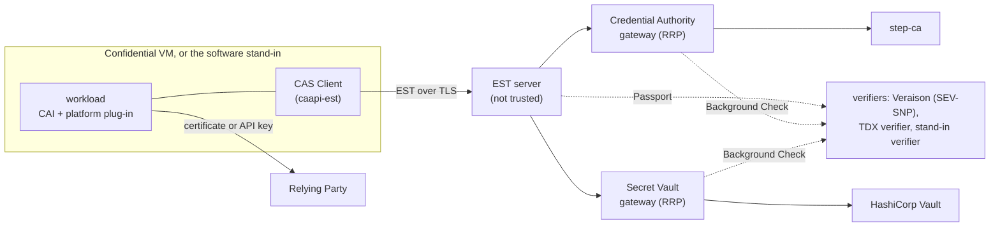

# attestation-bench

A reproducible test bench for **TACRA**, Trustworthy Acquisition of Credentials using Remote Attestation. In TACRA, a
workload in a confidential VM gets a credential (an X.509 certificate or an API key) only after its hardware has proven
what it runs, and the request travels through intermediaries it does not trust.

With this repository you can:

- **run TACRA end to end** on a laptop in minutes, with a software stand-in for the confidential hardware;
- **run it on real hardware**, AMD SEV-SNP and Intel TDX, in your own Google Cloud or AWS account;
- **attack it**: change one input at a time and see each refused for its own reason;
- **replay the redirection experiment** ([TACRA issue #20](https://github.com/TheBankster/rats-tacra/issues/20)): one
  Evidence offered to two Credential Authorities;
- **bring up a fictional bank** in the cloud, whose payment service gets its database certificate and partner API key
  only by attestation, and **make banks of your own** from it (`make bank-new`);
- **keep every run as evidence**: each run writes a directory with what it did, its results and their SHA-256.

> **Private.** Built for the TWI SIG's TACRA work: the architecture draft
> [draft-novak-rats-tacra](https://datatracker.ietf.org/doc/draft-novak-rats-tacra/) and its EST profile,
> [draft-novak-lamps-tacra-est](https://github.com/TheBankster/lamps-tacra-est), whose reference implementation is
> [tacra-est](https://github.com/nikolaichuk7/tacra-est). The TACRA
> proof of concept this bench builds on is the SIG's: [docs/tacra-poc/](docs/tacra-poc/README.md).

## Quick start: on your laptop, no cloud, no cost

You need macOS or Linux, Go 1.26.5 or later, and Python 3.10 or later. `make doctor` checks the rest and says how to
install what is missing.

```bash
make doctor     # checks this machine; ends with "Ready for make setup."
make setup      # builds and starts the bench in ~/.attestation-bench; ends with "The bench is up in ..."
make demo       # VERDICT PASS: all 10 Targets: credential acquired and admitted by the relying party
make attacks    # VERDICT PASS: 132 checks: the honest Evidence passed, every attack refused for its own reason
make redirect   # the #20 table: which Credential Authority issued, with and without the RRP identifier
```

Every run judges itself against what its experiment expects and ends with `VERDICT PASS` or `VERDICT FAIL`; on FAIL,
`make` fails. Locally, the workload's "hardware" is a software stand-in TEE: it signs its reports with a key in a file and gives
**no security at all**. It exists so that every flow and every check can run anywhere. The gateways accept it only
because the bench's own configuration allows it; a real deployment never does. Step by step, with what each step
prints: [docs/getting-started.md](docs/getting-started.md).

## On real hardware, in your own cloud account

Each command below creates one small confidential VM in the project or account your `gcloud` or `aws` CLI is signed in
to, runs, copies the results back, deletes the VM and checks that it is gone.

```bash
make demo     PLATFORM=gcp-snp    # also gcp-tdx, aws-snp
make attacks  PLATFORM=gcp-tdx
make redirect PLATFORM=aws-snp
```

| `PLATFORM` | Hardware | Machine | Report signed by |
|---|---|---|---|
| `local` (default) | none: the software stand-in TEE | this machine | a key in a file |
| `gcp-snp` | AMD SEV-SNP, Google Cloud | `n2d-standard-2`, AMD Milan | the chip's VCEK |
| `gcp-tdx` | Intel TDX, Google Cloud | `c3-standard-4` | the TD's Quoting Enclave, certified by Intel (PCK) |
| `aws-snp` | AMD SEV-SNP, AWS EC2 | `c6a.large` | a VLEK: AMD's key for the cloud provider |

Setup, quotas, cost and cleanup per platform: [docs/hardware/](docs/hardware/README.md). The cloud Demo Bank:
[docs/demo-bank.md](docs/demo-bank.md).

## How it fits together



The workload asks for a credential for a **Target**. Its platform plug-in binds the request (the freshness element, the
Target, the RRP's identifier, and the CSR or the key that will receive the secret) into the hardware report. The
**RRP**, the party that issues or releases the credential, recomputes that binding itself and checks the verifier's
signed result (an EAR) before it acts. Everything between the workload and the RRP may be hostile: the EST server, the
network, the cloud. The ideas in plain words: [docs/concepts.md](docs/concepts.md); the components and ports:
[docs/architecture.md](docs/architecture.md).

## Status (6 October 2026)

| What | Result | Evidence |
|---|---|---|
| Local, `make check-mtls`: mutual TLS between all components | 47 of 47, in Passport and in Background Check | [Passport](e2e/evidence/20261006T222549Z-bench-mtls), [Background Check](e2e/evidence/20261006T223444Z-bench-mtls) |
| Hardware, `make demo`, three platforms × two RATS models | 10 of 10 Targets in each of the six runs | e.g. [GCP SEV-SNP, Passport](e2e/evidence/20261006T222601Z-gcp-sev-snp-e2e-passport), [AWS SEV-SNP, Background Check](e2e/evidence/20261006T224133Z-aws-sev-snp-e2e-background-check) |
| Hardware, `make attacks` | every attack refused for its own reason: 162 checks in process and 50 through Veraison on each SEV-SNP platform, 82 on TDX | [GCP SEV-SNP](hwcheck/evidence/20261006T224346Z-gcp-sev-snp), [GCP TDX](hwcheck/evidence/20261006T225040Z-gcp-tdx), [AWS SEV-SNP](hwcheck/evidence/20261006T225323Z-aws-sev-snp) |
| Hardware, `make redirect` | 20 of 20 cases on each platform, as in the table above | [GCP SEV-SNP](hwcheck/evidence/20261006T225552Z-gcp-snp-redirect), [GCP TDX](hwcheck/evidence/20261006T225943Z-gcp-tdx-redirect), [AWS SEV-SNP](hwcheck/evidence/20261006T230316Z-aws-snp-redirect) |
| The Demo Bank in the cloud | three payments from confidential VMs went through; an ordinary VM and an unapproved launch were refused | [run](e2e/evidence/20261006T230714Z-demo-bank) |

Every hardware result above was compared check by check with the previous runs and found identical. What a run does
**not** prove: [docs/limits.md](docs/limits.md).

## Documentation

| Read | To |
|---|---|
| [Getting started](docs/getting-started.md) | go from a fresh clone to a passing local run, step by step |
| [Concepts](docs/concepts.md) | understand TACRA's terms: Target, RRP, Evidence, binding, Freshness Kinds, Passport, Background Check |
| [Architecture](docs/architecture.md) | see every component, port and trust boundary |
| [Hardware](docs/hardware/README.md) | run on GCP SEV-SNP, GCP TDX and AWS SEV-SNP |
| [Demo Bank](docs/demo-bank.md) | run the fictional bank in the cloud, or make your own |
| [Attacks](docs/attacks.md) | see each attack the bench tries, what stops it and what result to expect |
| [Results](docs/results.md) | read a run directory |
| [Limits](docs/limits.md) | know what the bench does not prove |
| [Troubleshooting](docs/troubleshooting.md), [FAQ](docs/faq.md) | get unstuck |
| [Packs](packs/README.md), [Trust inputs](trust/README.md) | change what a bank issues and which launches it approves |
| [Contributing](CONTRIBUTING.md), [Security](SECURITY.md), [Changelog](CHANGELOG.md) | work on the bench |

## Repository layout

| Path | What | From |
|---|---|---|
| `cai/`, `platform/`, `proto/`, `gen/`, `client/`, `server/`, `deploy/`, `est/` | the TACRA proof of concept: the Credential Acquisition Interface, the platform plug-ins, the CAAPI | the TWI SIG, with our merged contributions |
| `rrp/` | the RRP gateways (Credential Authority, Secret Vault), the TDX verifier and the stand-in's verifier | the bench |
| `bundle/` | the signed container that carries a released secret | the bench |
| `e2e/` | the end-to-end runs, the workload and CAS Client programs, the Demo Bank | the bench |
| `hwcheck/` | the attack suite and the redirection experiment, on hardware and locally | the bench |
| `scripts/`, `bench.mk` | setup, the local trust zone, the checks; `make help` lists every target | the bench |
| `packs/`, `trust/` | what each bank issues, and the inputs the verifiers trust | the bench |
| `third_party/` | the EST server, Veraison and go-gen-ref: pinned upstream commits plus our patches | upstream, our patches |
| `*/evidence/` | the run directories behind every number in the docs | runs |

## Licence

Apache License 2.0: [LICENSE](LICENSE). Third-party components and their licences: [NOTICE](NOTICE).
