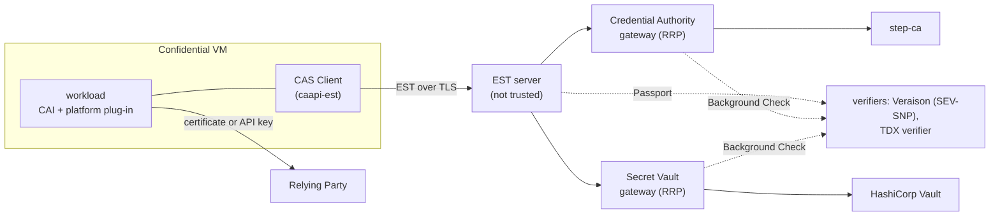

# attestation-bench

A reproducible test bench for **TACRA**, Trustworthy Acquisition of Credentials using Remote Attestation. In TACRA, a
workload in a confidential VM gets a credential (an X.509 certificate or an API key) only after its hardware has proven
what it runs, and the request travels through intermediaries it does not trust.

With this repository you can:

- **run TACRA end to end on real hardware**, AMD SEV-SNP and Intel TDX, in your own Google Cloud or AWS account:
  nothing stands in for the hardware;
- **attack it**: change one input at a time and see each refused for its own reason;
- **replay the redirection experiment** ([TACRA issue #20](https://github.com/TheBankster/rats-tacra/issues/20)): one
  Evidence offered to two Credential Authorities, also with the second keeping an epoch of its own or the intermediary
  starting there, and to two Secret Vaults, and what the intermediary relays rewritten
  ([#19](https://github.com/TheBankster/rats-tacra/issues/19)), in Background Check and in Passport;
- **bring up a fictional bank** in the cloud, whose payment service gets its database certificate and partner API key
  only by attestation, and **make banks of your own** from it (`make bank-new`);
- **keep every run as evidence**: each run writes a directory with what it did, its results, its verdict (`PASS` or
  `FAIL`) and the SHA-256 of every file; `make report` lists them all.

> **Private.** The TWI SIG's bench for its TACRA work: the architecture draft
> [draft-novak-rats-tacra](https://datatracker.ietf.org/doc/draft-novak-rats-tacra/) and its EST profile,
> [draft-novak-lamps-tacra-est](https://github.com/TheBankster/lamps-tacra-est), which the group's EST server
> implements ([TWI-Unified-Model/globalsign-est](https://github.com/TWI-Unified-Model/globalsign-est)). The bench
> builds that server from one of its commits under `third_party`, with the bench's patches, and keeps the parts of
> the SIG's TACRA proof of concept that it runs ([CONTRIBUTING.md](CONTRIBUTING.md)). How each release was checked:
> [docs/verification.md](docs/verification.md).

## Quick start

You need macOS or Linux, Go 1.26.5 or later and Python 3.10 or later. `make doctor` checks the rest and says how to
install what is missing. The first four commands below need no cloud account. The three after them each create one
small confidential VM in a Google Cloud project or an AWS account that can create them, with its CLI signed in
([docs/hardware/](docs/hardware/README.md)).

```bash
make doctor                     # checks this machine; ends with "Ready for make setup."
make setup                      # builds and starts the trust zone in ~/.attestation-bench
make check-mtls                 # VERDICT PASS: 40 of 40 checks as expected: only the allowed components, over TLS 1.3
make test-live                  # the EST wire format, and the committed runs appraised again by the live verifiers
make demo     PLATFORM=gcp-snp  # VERDICT PASS: all 10 Targets: …; admitted under the bench's waiver: Milan bit 4: …
make attacks  PLATFORM=gcp-snp  # VERDICT PASS: 262 checks: …; … the bench's waiver …; exposure, the guest's clock: …
make redirect PLATFORM=gcp-snp  # the #20 table, then the conduit's #19 rewrites (PASSPORT=1: in Passport)
```

On SEV-SNP every verdict names the bench's waiver: the platform rule requires the mitigation bit AMD-SB-3034
names for Milan, no Google Cloud or AWS host sets it, and a bank's rule refuses those hosts
([docs/limits.md](docs/limits.md)).

The trust zone (the EST server, the RRP gateways, the verifiers, step-ca, Vault) runs on your machine, and
`make test-live` appraises the real Evidence of the committed hardware runs again through its live verifiers. No run
of the protocol happens without the cloud: nothing stands in for the hardware. Each run creates one small confidential VM
in the project or account your `gcloud` or `aws` CLI is signed in to, runs the workload in it, copies the results
back, deletes the VM and checks that it is gone. Every run judges itself against what its experiment expects and ends
with `VERDICT PASS` or `VERDICT FAIL`; on FAIL, `make` fails. Step by step, with what each step prints:
[docs/getting-started.md](docs/getting-started.md).

| `PLATFORM` | Hardware | Machine | Report signed by |
|---|---|---|---|
| `gcp-snp` | AMD SEV-SNP, Google Cloud | `n2d-standard-2`, AMD Milan | the chip's VCEK |
| `gcp-tdx` | Intel TDX, Google Cloud | `c3-standard-4` | the TD's Quoting Enclave, certified by Intel (PCK) |
| `aws-snp` | AMD SEV-SNP, AWS EC2 | `c6a.large` | a VLEK: AMD's key for the cloud provider |

Setup, quotas, cost and cleanup per platform: [docs/hardware/](docs/hardware/README.md). The cloud Demo Bank:
[docs/demo-bank.md](docs/demo-bank.md).

## How it fits together



The workload asks for a credential for a **Target**. Its platform plug-in binds the request (the freshness element, the
Target, the RRP's identifier, and the CSR or the key that will receive the secret) into the hardware report. The
**RRP**, the party that issues or releases the credential, recomputes that binding itself and checks the verifier's
signed result (an EAR) before it acts. Everything between the workload and the RRP may be hostile: the EST server, the
network, the cloud. The ideas in plain words: [docs/concepts.md](docs/concepts.md); the components and ports:
[docs/architecture.md](docs/architecture.md).

## What the bench shows

Every number here has its run directory in the repository, named by the time of the run. `make report` lists them
with their verdicts, and [docs/verification.md](docs/verification.md) says how each release was checked and what the
checks found.

| What | Result | Evidence |
|---|---|---|
| The trust zone, `make check-mtls`: mutual TLS between all components | 40 of 40 checks, in Passport and in Background Check: only the allowed components, over TLS 1.3 | [Passport](e2e/evidence/20261025T223654Z-bench-mtls-passport), [Background Check](e2e/evidence/20261007T172900Z-bench-mtls-background-check) |
| The trust zone, `make test-live`: the EST wire format, and the committed hardware runs appraised again | the attest-* messages as the draft's CDDL defines them, through the running EST server. Then the Evidence of every committed attack run, appraised again by the live verifiers: the honest Evidence passes and each changed binding fails, as when the run was made | the runs under `hwcheck/evidence/`, in CI on every change |
| Hardware, `make demo`: three platforms in both RATS models | 10 of 10 Targets in each run. On TDX under the platform rule. On SEV-SNP under the bench's named waiver `admitted without bit 4, AMD-SB-3034`, which each verdict names, since no Google Cloud or AWS host attests that mitigation ([docs/limits.md](docs/limits.md)) | [GCP SEV-SNP, Passport](e2e/evidence/20261025T232331Z-gcp-sev-snp-e2e-passport), [GCP SEV-SNP, Background Check](e2e/evidence/20261025T232650Z-gcp-sev-snp-e2e-background-check), [GCP TDX, Passport](e2e/evidence/20261025T225030Z-gcp-tdx-e2e-passport), [GCP TDX, Background Check](e2e/evidence/20261011T192727Z-gcp-tdx-e2e-background-check), [AWS SEV-SNP, Passport](e2e/evidence/20261025T225259Z-aws-sev-snp-e2e-passport), [AWS SEV-SNP, Background Check](e2e/evidence/20261011T192535Z-aws-sev-snp-e2e-background-check) |
| Hardware, `OTHER_PLATFORM=1 make demo`: a platform's genuine Evidence at the Targets of the other platform's verifier | every Target refused: in Passport after appraisal, in Background Check before it | [GCP SEV-SNP](e2e/evidence/20261007T175538Z-gcp-sev-snp-e2e-passport-other-platform), [AWS SEV-SNP](e2e/evidence/20261007T175845Z-aws-sev-snp-e2e-passport-other-platform), [GCP TDX](e2e/evidence/20261007T180040Z-gcp-tdx-e2e-passport-other-platform), [GCP TDX, Background Check](e2e/evidence/20261007T173902Z-gcp-tdx-e2e-background-check-other-platform) |
| Hardware, `UNAPPROVED=1 make demo`: an SEV-SNP launch the bench does not approve (four vCPUs) | 10 of 10 Targets refused, Veraison `contraindicated` | [GCP SEV-SNP](e2e/evidence/20261007T175016Z-gcp-sev-snp-e2e-passport-unapproved), [AWS SEV-SNP](e2e/evidence/20261007T175320Z-aws-sev-snp-e2e-passport-unapproved) |
| Hardware, `make attacks`: one input changed at a time, as an intermediary could | every attack refused for its own reason: 232 checks on each SEV-SNP platform and 142 on TDX, the platform rule's among them. The bench's rule admits the honest results, on SEV-SNP under its waiver, and a bank's rule refuses SEV-SNP for bit 4. One exposure, reported as one: absent-timestamp Evidence made with the guest's clock 300 s ahead is taken from about 290 s after it was made, and again past 400 s, with `max_age` 120 s, the seconds in each run's verdict. The four other Freshness Kinds are taken at once and do not rest on the guest's clock, and Evidence made with the clock behind is refused | [GCP SEV-SNP](hwcheck/evidence/20261025T232947Z-gcp-sev-snp), [AWS SEV-SNP](hwcheck/evidence/20261011T194051Z-aws-sev-snp), [GCP TDX](hwcheck/evidence/20261011T194919Z-gcp-tdx) |
| Hardware, `make redirect`: one Evidence offered to two Credential Authorities, and what the intermediary relays rewritten | the pass without the RRP identifier, the binding the code makes: on a shared epoch marker the second Credential Authority issues for every Freshness Kind but present-nonce, the nonce it never issued. At the first Credential Authority the intermediary's rewrites are refused: a made-up Handle, another Freshness Kind, a credential type not offered, another workload's Credential Hint. The other credential type the Target offers is issued for every kind but present-nonce, since nothing binds the type ([docs/attacks.md](docs/attacks.md), section 2). Measured with the RRP identifier in the binding as well, the second Credential Authority refused every kind ([docs/rrp-identifier.md](docs/rrp-identifier.md)) | Background Check: [GCP SEV-SNP](hwcheck/evidence/20261007T204444Z-gcp-snp-redirect), [GCP TDX](hwcheck/evidence/20261007T204937Z-gcp-tdx-redirect), [AWS SEV-SNP](hwcheck/evidence/20261007T205428Z-aws-snp-redirect). Passport: [GCP SEV-SNP](hwcheck/evidence/20261007T205826Z-gcp-snp-redirect-passport), [GCP TDX](hwcheck/evidence/20261007T210314Z-gcp-tdx-redirect-passport), [AWS SEV-SNP](hwcheck/evidence/20261007T210728Z-aws-snp-redirect-passport) |
| `make redirect` with `REDIRECT_VARIANT=own-epochs`, `start-ca2` and `vault` | with an epoch marker of its own, the second Credential Authority issues without the RRP identifier for absent-timestamp and absent-none alone. When the intermediary starts the exchange there, it issues for every kind but absent-epoch, present-nonce included. On the Secret Vaults, the second releases the key for every kind but present-nonce. With the RRP identifier bound, the second refused all five kinds in each variant | [own epochs](hwcheck/evidence/20261008T031349Z-gcp-snp-redirect-own-epochs), [start at the second](hwcheck/evidence/20261008T031807Z-gcp-snp-redirect-start-ca2), [the Secret Vaults](hwcheck/evidence/20261008T041327Z-gcp-snp-redirect-vault), and the runs of the other platforms and of Passport beside them ([docs/attacks.md](docs/attacks.md), section 2) |
| `make redirect` with `REDIRECT_VARIANT=replay` and `replay-vault` | the same request a second time is refused with present-nonce, whose Handle serves once, and served again with the other four Freshness Kinds. One Evidence then yields two credentials, or two releases, both for the Attester's own key | [GCP SEV-SNP](hwcheck/evidence/20261008T184000Z-gcp-snp-redirect-replay), [GCP TDX](hwcheck/evidence/20261008T190244Z-gcp-tdx-redirect-replay), [AWS SEV-SNP](hwcheck/evidence/20261008T185320Z-aws-snp-redirect-replay), and the Secret Vault and Passport runs beside them |
| Hardware, the intermediary's redirect drill, `CONDUIT_ATTACK=redirect make demo`, also with `COPIES_OWN_KEYS=1` | the second RRPs' credentials are admitted when they issue under the PKI, or seal under the keys, the Attester already trusts. They are refused for their origin when the second Secret Vault seals under keys of its own | [GCP SEV-SNP](e2e/evidence/20261011T155450Z-gcp-sev-snp-e2e-passport-conduit-redirect), [AWS SEV-SNP](e2e/evidence/20261011T155756Z-aws-sev-snp-e2e-passport-conduit-redirect), [GCP TDX](e2e/evidence/20261011T160001Z-gcp-tdx-e2e-passport-conduit-redirect), own keys: [GCP SEV-SNP](e2e/evidence/20261011T160608Z-gcp-sev-snp-e2e-passport-conduit-redirect-own-keys) ([docs/attacks.md](docs/attacks.md), section 6.3) |
| Hardware, the intermediary and the Retrieval container, `CONDUIT_ATTACK=… make demo` | in each drill the five Enrollments are admitted, and each Retrieval the intermediary acted on is refused. Its own container, TACRA's option of the CAS Server encrypting to CEKpub, is refused for its origin. The Vault's container of the Retrieval before is refused for its associated data. A Credential Hint the Target serves no group to is refused by the Vault, and the hint of another group the Vault serves to the same launches is refused by the CAI. In the `verifier` drill, with the EST server as the attacking intermediary in Passport, the Credential Authority refuses each Enrollment's Attestation Results signed again with the intermediary's own key, since none of the Verifiers it takes signed them. The five Retrievals are admitted. Which check carries each: [docs/attacks.md](docs/attacks.md), section 6 | [GCP SEV-SNP, seal](e2e/evidence/20261008T003630Z-gcp-sev-snp-e2e-passport-conduit-seal), [AWS SEV-SNP, hint-group](e2e/evidence/20261008T010204Z-aws-sev-snp-e2e-passport-conduit-hint-group), [GCP TDX, swap](e2e/evidence/20261008T004908Z-gcp-tdx-e2e-passport-conduit-swap), [GCP SEV-SNP, verifier](e2e/evidence/20261008T234813Z-gcp-sev-snp-e2e-passport-conduit-verifier) |
| What attest-initiate costs, `make demo` | of 60 acquisitions on the three platforms in both models, the median Initiate took 259 ms from the guest, through the bench's SSH tunnel to the EST server, of a 564 ms acquisition. 1.35 ms of it was spent in the EST server and the RRP. A CAS Client that completed Initiate locally would save that round trip | [GCP SEV-SNP, Passport](e2e/evidence/20261007T215301Z-gcp-sev-snp-e2e-passport), [AWS SEV-SNP, Background Check](e2e/evidence/20261007T220649Z-aws-sev-snp-e2e-background-check) |
| The Demo Bank in the cloud, `make bank-up`, `make bank-pay` | its rule waives nothing: the payment from TDX goes through, the payments from Google Cloud and AWS SEV-SNP are refused for bit 4, and an ordinary VM and an unapproved launch get no credential, in Passport and in Background Check | [Passport](e2e/evidence/20261007T183914Z-demo-bank), [Background Check](e2e/evidence/20261007T193224Z-demo-bank) |
| A bank of your own, `make bank-new NAME=acme-bank` | its own Targets, RRP identifiers and names: the ledger admits `payments.workload.acme-bank.example` from TDX, and the payment from GCP SEV-SNP is refused for bit 4, as the Demo Bank's | [run](e2e/evidence/20261007T195519Z-acme-bank) |

```bash
make report                                              # your runs, one row each with its verdict
make report RUNS="e2e/evidence/* hwcheck/evidence/*"     # the repository's runs
```

What a run does **not** prove: [docs/limits.md](docs/limits.md).

## Documentation

| Read | To |
|---|---|
| [Getting started](docs/getting-started.md) | go from a fresh clone to a passing run on hardware, step by step |
| [The RRP identifier, both ways](docs/rrp-identifier.md) | the protocol with the RRP identifier in the binding and without it, measured on the same events (TACRA #20): what the identifier changes, what it costs, the text that follows |
| [The threat model](docs/threat-model.md) | the Credential Acquisition System as the attacker: what each role holds and what bounds it, the integrity half measured, the confidentiality half as the open choice, the two texts for the RRP identifier, and a coverage table of what the conduit can do to each value |
| [Concepts](docs/concepts.md) | understand TACRA's terms: Target, RRP, Evidence, binding, Freshness Kinds, Passport, Background Check |
| [Architecture](docs/architecture.md) | see every component, port and trust boundary |
| [Hardware](docs/hardware/README.md) | run on GCP SEV-SNP, GCP TDX and AWS SEV-SNP |
| [Demo Bank](docs/demo-bank.md) | run the fictional bank in the cloud, or make your own |
| [Attacks](docs/attacks.md) | see each attack the bench tries, what stops it and what result to expect |
| [Results](docs/results.md) | read a run directory |
| [Limits](docs/limits.md) | know what the bench does not prove |
| [Verification](docs/verification.md) | see how each release was checked, gate by gate, and what the checks found |
| [Troubleshooting](docs/troubleshooting.md), [FAQ](docs/faq.md) | get unstuck |
| [Packs](packs/README.md), [Trust inputs](trust/README.md) | change what a bank issues and which launches it approves |
| [Contributing](CONTRIBUTING.md), [Security](SECURITY.md), [Changelog](CHANGELOG.md) | work on the bench |

## Repository layout

| Path | What | From |
|---|---|---|
| `cai/`, `platform/`, `proto/`, `gen/` | the TACRA proof of concept's code the bench runs: the Credential Acquisition Interface, the platform plug-ins, the CAAPI's definitions | the TWI SIG, with our merged contributions |
| `rrp/` | the RRP gateways (Credential Authority, Secret Vault) and the TDX verifier | the bench |
| `bundle/` | the signed container that carries a released secret | the bench |
| `e2e/` | the end-to-end runs, the workload and CAS Client programs, the Demo Bank | the bench |
| `hwcheck/` | the attack suite and the redirection experiment, on hardware | the bench |
| `scripts/`, `bench.mk` | setup, the trust zone, the checks; `make help` lists every target | the bench |
| `packs/`, `trust/` | what each bank issues, and the inputs the verifiers trust | the bench |
| `third_party/` | the EST server, Veraison and go-gen-ref: pinned upstream commits plus our patches | upstream, our patches |
| `*/evidence/` | the run directories behind every number in the docs | runs |

## Licence

Apache License 2.0: [LICENSE](LICENSE). Third-party components and their licences: [NOTICE](NOTICE).
