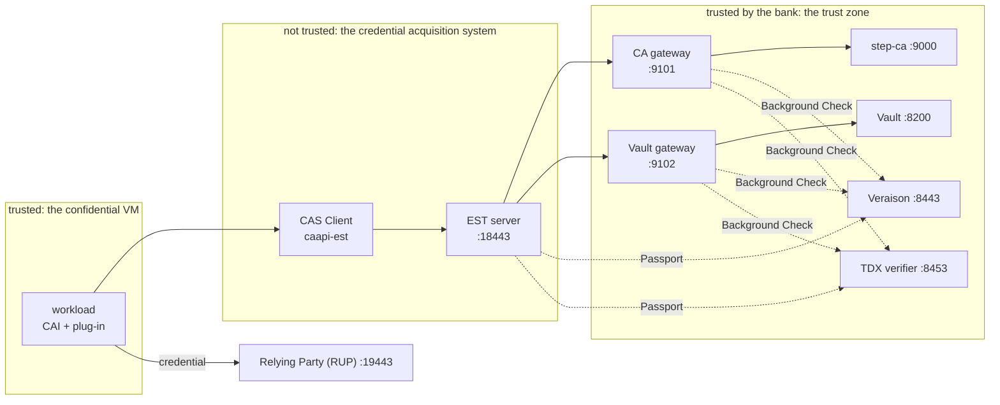

# Architecture

Every component of the bench, where it runs, what it listens on, who may call it, and which parts are trusted. The
terms are explained in [concepts.md](concepts.md).

## Trust boundaries



- **Trusted**: the workload's TEE, and the trust zone the bank runs: the RRPs and what stands behind them, and the
  verifiers.
- **Not trusted**: everything between the workload and the RRPs, the CAS Client, the EST server and the network.
  Whatever they do, an RRP issues only to Evidence whose binding it recomputed itself, under a verifier result it
  checked itself.
- **Not involved**: the Relying Party. It authenticates the workload with an ordinary credential and knows nothing of
  attestation.

The trust zone runs on one machine, yours; in every run the workload and the CAS Client run in the confidential VM
and reach the EST server through an SSH reverse tunnel, with TLS end to end over it. In the Demo Bank each part has a
VM of its own ([demo-bank.md](demo-bank.md)).

## Components

| Component | Program | Listens on | Role |
|---|---|---|---|
| Workload | `e2e-attester` (`e2e/cmd`) | | the Attester: the TACRA proof of concept's CAI with a platform plug-in (`platform/`: SEV-SNP, TDX) |
| CAS Client | `caapi-est` (`e2e/cmd`) | `127.0.0.1:50061` (the CAAPI, for the CAI) | turns CAAPI calls into EST requests |
| EST server | GlobalSign's EST server with TACRA's `attest-*` resources (`third_party/globalsign-est`) | `127.0.0.1:18443` | the CAS Server: routes each Target to its RRP; in Passport it asks the verifier |
| Credential Authority gateway | `ca-gateway` (`rrp/cmd`) | `127.0.0.1:9101` | an RRP: mints Freshness Handles, checks the binding and the verifier result, asks step-ca to sign |
| Second Credential Authority | `ca-gateway` with `ca-gateway-2.json` | `127.0.0.1:9103` | the same, another RRP identifier: the second bank of `make redirect` |
| Secret Vault gateway | `vault-gateway` (`rrp/cmd`) | `127.0.0.1:9102` | an RRP: the same checks, then reads the secret from Vault and releases it in the signed container |
| step-ca | Smallstep `step-ca` | `127.0.0.1:9000` | the workload CA |
| HashiCorp Vault | `vault` | `127.0.0.1:8200` | stores the secret the Vault gateway releases |
| Veraison | `vts`, `provisioning`, `verification`, `management` (`third_party/veraison-services`) | `127.0.0.1:50051` (VTS), `:9443`, `:8443`, `:10443` | the SEV-SNP verifier; provisioned with AMD's ARK and the approved launches (`trust/`) |
| TDX verifier | `tdx-verifier` (`rrp/cmd`) | `127.0.0.1:8453` | the TDX verifier: go-tdx-guest against Intel's collateral, and the approved MRTDs |
| Relying Party | `rup` (`e2e/cmd`) | `127.0.0.1:19443` | the RATS-unaware service: `/hello` admits a certificate of the workload CA for an allowed name, `/api` the API key |

`make status` lists the twelve that run in the trust zone. Their configuration is written by
`scripts/trustzone.py` from the pack ([../packs/README.md](../packs/README.md)); the files are in
`~/.attestation-bench/config/`.

## Who may call whom

Every channel inside the trust zone is TLS 1.3 and authenticates its caller, with a certificate of the bench's own
root wherever the server takes one (tacra-est requirement N23).
`make check-mtls` tries each channel with every kind of caller ([getting-started.md](getting-started.md), step 6).

| From | To | How the caller is authenticated |
|---|---|---|
| CAS Client | EST server | the server only: the CAS is not trusted, so the request's own Evidence is what counts |
| EST server | CA and Vault gateways | a client certificate, `est-server.bench.tacra.example` and no other (the Vault gateway's origin-keys route, which serves its public keys, takes any of the root) |
| EST server, gateways | TDX verifier | a client certificate of one of those three components |
| EST server, gateways | Veraison (verification) | a client certificate of the bench's root |
| CA gateway | step-ca | a one-time token per request, signed with the provisioner key the gateway holds |
| Vault gateway | Vault | a client certificate, plus a Vault token that may only read its Targets' secrets |
| workload | Relying Party | the credential it acquired |

The verifiers' signing keys reach the RRPs as files, never fetched from the verifiers at run time (tacra-est
requirement N24): `~/.attestation-bench/gateways/*.ear.jwk`.

## One Enrollment, Passport, `present-nonce`

```mermaid
sequenceDiagram
  participant W as workload (CAI + plug-in)
  participant C as CAS Client
  participant E as EST server
  participant G as CA gateway (RRP)
  participant V as verifier
  participant S as step-ca
  W->>C: AcquireCredential(Target)
  C->>E: attest-initiate(Target)
  E->>G: initiate
  G-->>E: Freshness Handle (nonce), RRP identifier
  E-->>C: handle, RRP identifier
  C-->>W: handle, RRP identifier
  Note over W: makes a key pair and a CSR;<br/>binding value = SHA-512(handle, Target, RRP id, CSR);<br/>the hardware signs a report holding it
  W->>C: Enroll(Evidence, CSR)
  C->>E: attest-enroll(Evidence, CSR)
  E->>V: new session (nonce = binding value), Evidence
  V-->>E: EAR, signed
  E->>G: handle, EAR, CSR
  Note over G: recomputes the binding value;<br/>checks the EAR's signature, verdict and nonce;<br/>checks the handle is its own and unused
  G->>S: sign the CSR
  S-->>G: certificate
  G-->>E: certificate
  E-->>C: certificate
  C-->>W: certificate
```

In Background Check the EST server forwards the Evidence and its media type instead of an EAR, and the gateway opens
the verifier session itself. In Retrieval the CSR is CEKpub and the answer is the signed container. Absent kinds skip
the first round trip.

## Where things are on disk

| Path | Holds |
|---|---|
| `~/.attestation-bench/` (`BENCH_HOME`) | the running bench; never in git |
| `…/tls/` | the bench's TLS root, each service's certificate, `clients/`: the components' client certificates |
| `…/secrets/`, `…/gateways/` | private keys, Vault's unseal key, tokens; the verifiers' public keys given to the RRPs |
| `…/config/` | every service's configuration |
| `…/veraison/` | the Veraison deployment (`VERAISON_DEPLOYMENT`) |
| `…/runs/` (`RUNS_DIR`) | the run directories ([results.md](results.md)) |
| `…/*.log`, `…/logs/` | each service's log; `logs/setup.log` |
